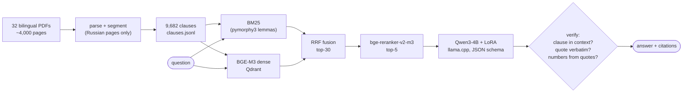
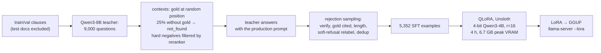

# kz-norms-llm

**A local LLM assistant for Kazakhstan building codes (СН РК / СП РК).** Ask a question in
plain language — get an answer grounded in the exact clause of the code, with a verbatim
quote that is machine-checked against the source. If the codes do not answer the question,
the model says `not_found` instead of guessing.

Everything runs on a single consumer GPU (RTX 3060 Ti, 8 GB) with open models and no paid APIs:
retrieval, a fine-tuned Qwen3-4B, a local Qwen3-8B teacher for synthetic data and as an
LLM judge.

Real output of the fine-tuned model (full pipeline, test document):

```
Q:  Можно ли сделать вход в гардеробную прямо из спальни?
A:  {"status": "answered",
     "answer": "Да, допускается при проектировании спальных помещений, из которых
                допускается осуществлять вход в гардеробную.",
     "citations": [{"clause_id": "zhilye-zdaniya:6.2.10",
                    "quote": "Спальные помещения проектируются непроходными, из них
                              допускается осуществлять вход: 1) в кладовую (или гардеробную);"}]}
    verify ✓  — the quote is found verbatim in СН РК 3.02-01-2023, п. 6.2.10
```

## Why

An engineer checking a project against building codes needs **the clause, not an opinion**.
A generic chatbot answers fluently and invents numbers. This project treats the problem as
*grounded* QA: the model may only use retrieved clauses, every claim must carry a quote, and
code — not the model — decides whether the quote is real.

## Results

Test set: 67 questions (57 answerable, 10 unanswerable) on **documents never seen in
training** (split by document groups, see below). *oracle* — the gold clause is guaranteed
to be in the context among distractors; *e2e* — full pipeline with real retrieval.

| oracle / e2e | Qwen3-4B base (prompt v4) | + QLoRA, data v1 | + QLoRA, data v2 |
|---|---|---|---|
| quotes pass verification | 0.84 / 0.89 | 0.97 / 0.97 | **0.97 / 1.00** |
| correct `answered` status when gold is present | 0.89 / 0.88 | 0.95 / 0.95 | **0.96 / 0.98** |
| numbers from the reference answer present | **0.83 / 0.88** | 0.75 / 0.77 | 0.80 / 0.69 |
| LLM judge: correct | **0.53 / 0.51** | 0.47 / 0.42 | 0.47 / 0.39 |
| LLM judge: wrong | **0.07 / 0.09** | 0.09 / 0.12 | 0.12 / 0.11 |
| median answer length, chars | 242 | 108 | 104 |

Retrieval on the test documents (58 answerable questions): Hit@5 — BM25 0.74, BGE-M3 0.93, hybrid (RRF) 0.95,
**hybrid + reranker 1.00**, MRR@10 0.88.

**What the numbers say — honestly:**
- Fine-tuning reliably fixes **format discipline**: verbatim quotes go from 84–89% to 97–100%,
  statuses become calibrated. This is the part a downstream system can rely on.
- On **meaning** (LLM judge), a well-prompted base model is as good or slightly better:
  the fine-tuned model shortens answers and occasionally picks a neighbouring clause.
  The differences between columns are 1–4 questions out of 57 — within noise (SE ≈ 0.065).
- An early "fine-tuned model is too terse" regression turned out to come mostly from the
  **prompt**, not the training data: re-evaluating the same adapter with prompt v4 doubled
  answer length and raised number recall from 0.59 to 0.75.
- The bottleneck is now **evaluation**, not the model: 57 questions cannot separate these
  models. Next step is a 150–200 question test set written by engineers.

## Architecture



Training side:



## Key design decisions

| Decision | Why |
|---|---|
| **Split by document groups**, not by question; test documents excluded even as distractors in synthetic contexts | A question-level split leaks: the model would see the same clause in training. СН and its companion СП stay on the same side. |
| **Russian pages only** (pages detected by Kazakh-specific letters ә ғ қ ң ө ұ ү һ і) | Official codes print the same text twice — Kazakh, then Russian. Keeping both duplicates every clause in retrieval and breaks verbatim quote checking. Kazakh *questions* still work: BGE-M3 is multilingual. |
| **Hybrid retrieval + reranker** | BM25 handles exact terms ("Л2", "п. 6.2.10"), dense handles paraphrases; the reranker fixes RRF's ordering (MRR 0.74 → 0.88). |
| **Structured output via JSON-schema grammar** (llama.cpp) | The model physically cannot produce invalid JSON; temperature 0. |
| **Deterministic `verify`** instead of trusting the model | Quote must be a substring of the cited clause after normalization; every number in the answer must come from a quote, the question or the context. Errors are split into "from context without a quote" vs "not in context". |
| **Same prompt template for synthetic data, training and inference** | Avoids train/serve skew. |
| **Local teacher (Qwen3-8B) + rejection sampling** | No paid API; quality comes from filtering, not from a bigger teacher. Teacher and retriever do not fit in 8 GB together, so the pipeline is staged (questions → contexts → answers) with a disk cache. |
| **`train_on_responses_only`** + mask check | Loss only on the answer (~5% of tokens). Training text is built as generation prompt + answer + `<\|im_end\|>` to avoid the empty `<think>` block Qwen3's template inserts. |
| **LoRA served as a separate GGUF** (no merge) | One base model, swappable adapters; the client checks `/lora-adapters` so base and fine-tuned runs cannot be confused. |
| **Decomposed LLM judge** | A holistic "is it correct?" verdict from an 8B judge collapsed to "incomplete" on almost everything. The judge now answers two narrow questions — *contradicts the reference?* and *what is missing?* — and code computes the verdict. |

## Quick start

Requirements: Python 3.11, [uv](https://docs.astral.sh/uv/), NVIDIA GPU with 8 GB+.
Inference works on Windows; training needs Linux or WSL2 (Unsloth).

```bash
uv sync
uv run kznorms ingest            # download codes from data/sources.csv → clauses.jsonl
uv run kznorms index             # BM25 + BGE-M3 → Qdrant (artifacts/)
uv run kznorms search "ширина лестничного марша" --mode hybrid_rerank --k 5
```

Serve the model with [llama.cpp](https://github.com/ggml-org/llama.cpp) and ask:

```bash
llama-server -m Qwen3-4B-Instruct-2507-Q4_K_M.gguf [--lora artifacts/lora/full_v2-f16.gguf] \
  -c 8192 -ngl 99 --host 127.0.0.1 --port 8085 --jinja
uv run kznorms ask "Можно ли сделать вход в гардеробную прямо из спальни?"
uv run kznorms ui                # Gradio → http://127.0.0.1:7860
```

Full pipeline:

```bash
uv run kznorms splits                                   # document-level train/val/test
uv run kznorms eval-retrieval                           # Hit@5, Recall@5, MRR@10
uv run kznorms synth --stage questions|contexts|answers # synthetic data with a local teacher
uv run kznorms train-llm                                # QLoRA (WSL2/Linux)
uv run kznorms export --run <run>                       # LoRA → GGUF
uv run kznorms eval-generation --model base|ft          # oracle / e2e
uv run kznorms judge --tags <report>,<report>           # LLM judge (Qwen3-8B)
uv run pytest                                           # 96 tests
```

## Repository layout

```
configs/         retrieval, synthetic data, SFT configs (YAML)
data/sources.csv list of codes with document groups and split
data/eval/       hand-labelled test questions with gold clauses
src/kznorms/
  ingest/        download, PDF/DOCX parsing, clause segmentation
  retrieval/     chunking, BM25, BGE-M3 + Qdrant, RRF, reranker
  rag/           prompt, llama.cpp client, verify, pipeline
  synth/         teacher, question generation, contexts, answers, filter
  train/         Unsloth QLoRA, GGUF export
  eval/          retrieval and generation metrics, LLM judge
  api/           Gradio UI
scripts/         overnight runs (synthetic data, training)
docs/HANDOFF.md  full engineering log: every decision, failure and measurement
```

## Limitations

- The test set is small (57 answerable questions) and partly written by someone who had seen
  the clauses — it is easier than real engineer questions.
- The LLM judge is from the same model family (Qwen) as the student and teacher; verdicts
  are spot-checked by hand.
- Answers are in Russian only; questions in Kazakh are understood through multilingual
  retrieval but not evaluated.
- Tables inside the codes are flattened into text (some clauses run to 10–30K characters);
  drawings are not used.

## Roadmap

1. Test set of 150–200 questions written without looking at the clauses; then ablations
   (500/1k/2k/4k examples, LoRA rank 8/16/32).
2. **Checking a project fragment against the codes**: take a paragraph of an explanatory note
   or a room schedule, extract the checkable claims, retrieve the relevant clauses, report
   violations with citations.
3. Bilingual index: link Kazakh and Russian versions of each clause by number, answer in the
   language of the question.
4. Fine-tuning the embedding model on synthetic question–clause pairs.
