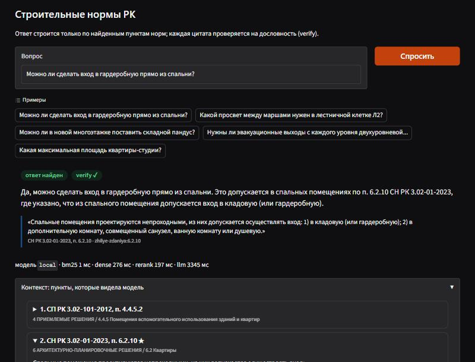
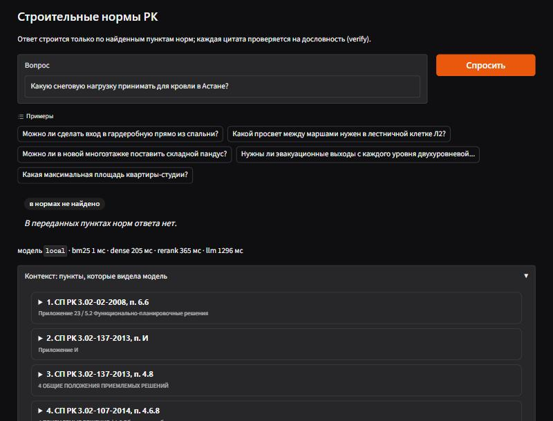
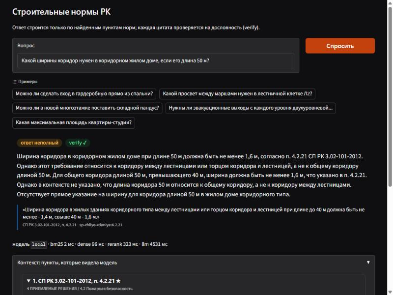
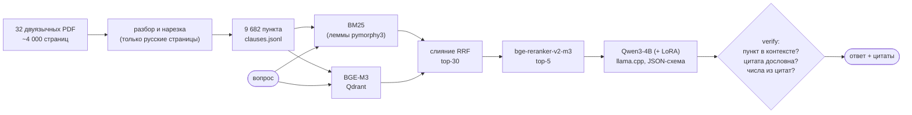
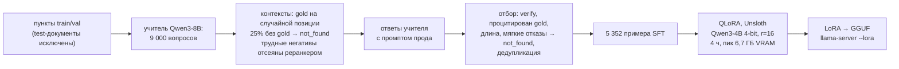

# kz-norms-llm

**Локальный LLM-помощник по строительным нормам Республики Казахстан (СН РК / СП РК).**
Задаёшь вопрос обычными словами и получаешь ответ, опирающийся на конкретный пункт нормы,
с дословной цитатой, которую код сверяет с источником. Если в нормах ответа нет, модель
честно отвечает `not_found`, а не придумывает.

Всё работает на одной домашней видеокарте (RTX 3060 Ti, 8 ГБ), на открытых моделях и без
платных API: поиск, дообученная Qwen3-4B и локальная Qwen3-8B (учитель для синтетических
данных и LLM-судья).



*Вопрос → найденные пункты норм → ответ модели → цитата, проверенная кодом (verify ✓).
Под ответом — время каждого этапа и пункты, которые видела модель (★ — тот, на который
она сослалась).*

## Зачем

Инженеру, который проверяет проект на соответствие нормам, нужен **пункт, а не мнение**.
Обычный чат-бот отвечает гладко и выдумывает числа. Здесь задача поставлена как ответы
*со ссылкой на источник*: модель может опираться только на найденные пункты, каждое
утверждение подкрепляется цитатой, а настоящая ли цитата, решает код, а не модель.

<table>
<tr>
<td width="50%"></td>
<td width="50%"></td>
</tr>
<tr>
<td><b>Честный отказ.</b> Про снеговую нагрузку в корпусе норм ничего нет: поиск нашёл
только похожие пункты, и модель ответила «в нормах не найдено», не подбирая ответ из
соседних.</td>
<td><b>Перестраховка базовой модели.</b> Ответ верный (не менее 1,6 м, цитата проверена),
но модель сомневается, относится ли пункт к этому коридору, ставит «неполный» и
рассуждает лишнее. Такие длинные ответы — цена полноты базы.</td>
</tr>
</table>

## Результаты

Тестовый набор — 183 вопроса (147 с ответом, 36 без ответа) по **документам, которых не
было в обучении** (сплит по группам документов, см. ниже). Каждый эталонный ответ и
gold-пункт сверен с текстом нормы. Вопросы без ответа проверены по всему корпусу
(9 682 пункта), многие из них — *ловушки*: есть пункт на ту же тему, но для другого типа
здания или о другом параметре. *oracle* — gold-пункт гарантированно в контексте среди
отвлекающих; *e2e* — весь конвейер с настоящим поиском.

| oracle / e2e | Qwen3-4B, база (промпт v4) | + QLoRA, данные v1 | + QLoRA, данные v2 |
|---|---|---|---|
| цитаты прошли проверку (verify) | 0.84 / 0.81 | **0.97 / 0.95** | 0.92 / 0.97 |
| честный `not_found` на вопросах без ответа | 0.78 / 0.78 | **0.89 / 0.89** | 0.83 / 0.83 |
| статус `answered`, когда gold в контексте | 0.85 / 0.80 | 0.92 / 0.92 | **0.93 / 0.95** |
| числа из эталона есть в ответе | **0.81 / 0.78** | 0.64 / 0.67 | 0.58 / 0.55 |
| LLM-судья: верно | **0.47 / 0.46** | 0.44 / 0.45 | 0.40 / 0.36 |
| LLM-судья: неверно | **0.07 / 0.09** | 0.07 / 0.11 | 0.12 / 0.13 |
| медианная длина ответа, симв. | 240 | 108 | 100 |

Поиск на том же наборе (147 вопросов с ответом): Hit@5 — BM25 0.80, BGE-M3 0.95,
гибрид (RRF) 0.94, **гибрид + реранкер 0.99**, MRR@10 0.94.

**Выводы:**
- Дообучение надёжно даёт **дисциплину**: дословных цитат больше (81–84% → 95–97%),
  честных отказов больше (78% → 89%), статусы точнее. На это может опираться система,
  которая использует ответы дальше.
- По **смыслу** (LLM-судья) дообучение **не помогает**. Парное сравнение на одних и тех же
  вопросах: база против данных v1 — 22 против 21 вопроса в e2e (разницы нет, тест знаков
  p = 1.0). Дообученные модели называют первое требование пункта и теряют остальные:
  «продухи в подвале нужны», но без «общей площадью не менее 1/400 площади пола». Поэтому
  доля чисел из эталона падает с 0.81 до 0.64.
- **Вторая итерация сделала хуже, а не лучше.** Данные v2 (ответы учителя со строгим
  промптом) проиграли данным v1 в e2e: 19 против 6 вопросов, p = 0.015. Наглядный пример
  того, почему каждое изменение данных нужно перемерять, а не предполагать.
- Первый тестовый набор (57 вопросов) это скрывал: там verify базы в e2e выглядел как 0.89,
  на 147 вопросах — 0.81. Маленький набор льстит.
- Практический вывод: **база + промпт v4 + `verify`** дают самые полные ответы; адаптер
  на данных v1 — выбор, когда строгий формат и отказы важнее полноты. Потеря полноты идёт
  от стиля ответов учителя, а не от размера модели: та же база 4B пишет полные ответы.

## Архитектура



Обучение:



## Ключевые решения

| Решение | Почему |
|---|---|
| **Сплит по группам документов**, а не по вопросам; test-документы не попадают даже в отвлекающие пункты синтетики | Сплит по вопросам протекает: модель увидела бы тот же пункт на обучении. СН и парный СП всегда по одну сторону. |
| **Только русские страницы** (казахские узнаются по буквам ә ғ қ ң ө ұ ү һ і) | Официальные нормы печатают один текст дважды: на казахском, потом на русском. С обоими языками каждый пункт дублировался бы в поиске, а дословная проверка цитат сломалась бы. Вопросы *на казахском* всё равно понимаются: BGE-M3 многоязычная. |
| **Гибридный поиск + реранкер** | BM25 ловит точные термины («Л2», «п. 6.2.10»), dense — перефразировки; реранкер исправляет порядок после RRF (MRR 0.82 → 0.94). |
| **Структурированный вывод через грамматику JSON-схемы** (llama.cpp) | Модель физически не может выдать невалидный JSON; temperature 0. |
| **Детерминированный `verify`** вместо доверия модели | Цитата должна быть подстрокой пункта после нормализации; каждое число ответа — из цитаты, вопроса или контекста. Ошибки разделены на «из контекста, но без цитаты» и «нет в контексте». |
| **Один шаблон промпта для синтетики, обучения и инференса** | Нет расхождения между обучением и продом (train/serve skew). |
| **Локальный учитель (Qwen3-8B) + отбор (rejection sampling)** | Без платных API; качество — за счёт фильтров, а не большого учителя. Учитель и поиск вместе не помещаются в 8 ГБ, поэтому конвейер разбит на этапы (вопросы → контексты → ответы) с кэшем на диске. |
| **`train_on_responses_only`** + проверка маски | Loss только по ответу (~5% токенов). Текст для обучения = промпт генерации + ответ + `<\|im_end\|>`, иначе шаблон Qwen3 вставляет пустой блок `<think>`. |
| **LoRA отдаётся отдельным GGUF** (без слияния) | Одна базовая модель, адаптеры сменные; клиент проверяет `/lora-adapters`, чтобы не перепутать базу и дообученную. |
| **LLM-судья из двух вопросов** | Общий вердикт «верно ли?» у судьи 8B скатывался в «неполно» почти на всё. Теперь судья отвечает на два узких вопроса — *противоречит ли эталону?* и *чего не хватает?*, — а вердикт считает код. |
| **Парный тест знаков** при сравнении моделей | Разница долей на 150 вопросах сравнима с шумом; сравнение на одних и тех же вопросах показывает, какие различия настоящие. |

## Быстрый старт

Нужно: Python 3.11, [uv](https://docs.astral.sh/uv/), видеокарта NVIDIA от 8 ГБ.
Инференс работает на Windows; обучение — на Linux или WSL2 (Unsloth).

```bash
uv sync
uv run kznorms ingest            # скачать нормы из data/sources.csv → clauses.jsonl
uv run kznorms index             # BM25 + BGE-M3 → Qdrant (artifacts/)
uv run kznorms search "ширина лестничного марша" --mode hybrid_rerank --k 5
```

Поднять модель в [llama.cpp](https://github.com/ggml-org/llama.cpp) и спросить:

```bash
llama-server -m Qwen3-4B-Instruct-2507-Q4_K_M.gguf [--lora artifacts/lora/full_r16-f16.gguf] \
  -c 8192 -ngl 99 --host 127.0.0.1 --port 8085 --jinja
uv run kznorms ask "Можно ли сделать вход в гардеробную прямо из спальни?"
uv run kznorms ui                # Gradio → http://127.0.0.1:7860
uv run kznorms serve             # HTTP API → http://127.0.0.1:8000/docs
```

### HTTP API

| эндпоинт | что делает |
|---|---|
| `POST /ask` `{"question": "...", "k": 5}` | поиск → LLM → verify; возвращает статус, ответ, цитаты, `verified`, `problems`, найденные пункты и время каждого этапа |
| `POST /search` `{"question": "...", "k": 5, "mode": "hybrid_rerank"}` | только поиск, без LLM |
| `GET /health` | сервис жив, какая модель подключена |

```bash
curl -X POST http://127.0.0.1:8000/ask -H "Content-Type: application/json" \
  -d '{"question": "Какой ширины коридор в коридорном доме длиной 50 м?"}'
```

Ответ — та же Pydantic-схема, что внутри конвейера: если цитата или число не прошли
проверку, клиент получает `verified: false` и список проблем. Модели поиска грузятся
один раз при старте; запросы к видеокарте идут по очереди (карта одна); если LLM
недоступна — `503` с понятным текстом; вход проверяется (`422`).

Весь конвейер:

```bash
uv run kznorms splits                                   # train/val/test по документам
uv run kznorms eval-retrieval                           # Hit@5, Recall@5, MRR@10
uv run kznorms synth --stage questions|contexts|answers # синтетика с локальным учителем
uv run kznorms train-llm                                # QLoRA (WSL2/Linux)
uv run kznorms export --run <run>                       # LoRA → GGUF
uv run kznorms eval-generation --model base|ft          # oracle / e2e
uv run kznorms judge --tags <отчёт>,<отчёт>             # LLM-судья (Qwen3-8B)
uv run kznorms qa-review --sample 20                    # выборочная ручная проверка эталонов
uv run pytest                                           # 104 теста
```

## Структура репозитория

```
configs/         конфиги поиска, синтетики, обучения (YAML)
data/sources.csv список норм с группами документов и сплитом
data/eval/       тестовые вопросы с gold-пунктами и эталонами
src/kznorms/
  ingest/        скачивание, разбор PDF/DOCX, нарезка на пункты
  retrieval/     фрагменты, BM25, BGE-M3 + Qdrant, RRF, реранкер
  rag/           промпт, клиент llama.cpp, verify, конвейер
  synth/         учитель, вопросы, контексты, ответы, фильтр
  train/         QLoRA (Unsloth), экспорт в GGUF
  eval/          метрики поиска и генерации, LLM-судья
  api/           FastAPI (/ask, /search, /health) и Gradio
scripts/         ночные прогоны (синтетика, обучение)
docs/HANDOFF.md  полный инженерный журнал: каждое решение, ошибка и измерение
```

